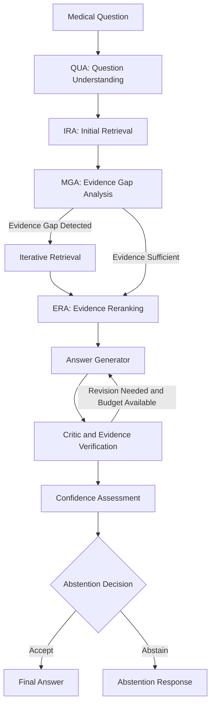

# RAGMedX-MA
### A Multi-Agent Iterative Retrieval Framework with Peer-Reviewed Generation for High-Confidence Medical Question Answering

RAGMedX-MA is a research-oriented medical question-answering framework that combines **Retrieval-Augmented Generation (RAG), hybrid information retrieval, multi-agent orchestration, evidence verification, and confidence-aware abstention**.

The system is designed to address a critical challenge in medical AI: generating answers that are not only relevant and informative but also grounded in supporting evidence. Instead of relying entirely on an LLM's internal knowledge, RAGMedX-MA retrieves relevant documents, evaluates evidence coverage, refines retrieval when necessary, and subjects generated answers to additional verification before determining whether a response should be delivered.

The framework uses a multi-agent workflow orchestrated through LangGraph to coordinate retrieval, evidence-gap analysis, reranking, answer generation, criticism, confidence assessment, and abstention decisions.

> **Research objective:** Investigate how iterative retrieval, evidence verification, and confidence-aware decision-making can improve the reliability of medical question answering while reducing unsupported responses.

---

## Table of Contents

- [Overview](#overview)
- [Problem Statement](#problem-statement)
- [Project Objectives](#project-objectives)
- [Key Features](#key-features)
- [System Architecture](#system-architecture)
- [Multi-Agent Workflow](#multi-agent-workflow)
- [Retrieval and Evidence Processing](#retrieval-and-evidence-processing)
- [Confidence and Abstention](#confidence-and-abstention)
- [Evaluation Framework](#evaluation-framework)
- [Technology Stack](#technology-stack)
- [Repository Structure](#repository-structure)
- [Installation and Setup](#installation-and-setup)
- [Running the Project](#running-the-project)
- [Research Limitations](#research-limitations)
- [Team](#team)
- [Disclaimer](#disclaimer)

---

## Overview

Large Language Models (LLMs) have demonstrated strong capabilities in natural language understanding and generation. However, medical question answering presents additional challenges because incorrect, incomplete, or unsupported answers can have serious consequences.

Traditional LLM-based systems may generate plausible responses without providing sufficient evidence. Conventional RAG systems address part of this problem by retrieving relevant documents and including them in the generation context. Nevertheless, a single retrieval pass may fail to retrieve important evidence, and retrieved documents may not adequately support every claim in the generated answer.

RAGMedX-MA extends the retrieval-augmented approach through a coordinated, multi-agent architecture.

The framework incorporates:

- **Hybrid information retrieval:** Combines dense semantic retrieval and sparse lexical retrieval to identify potentially relevant medical documents.
- **Iterative retrieval:** Evaluates evidence coverage and can initiate additional retrieval when important information is missing.
- **Evidence reranking:** Refines the ordering of retrieved documents before answer generation.
- **Peer-reviewed generation:** Uses a critic stage to examine generated responses and their supporting evidence.
- **Confidence assessment:** Evaluates the available support for a response before making a final decision.
- **Abstention mechanism:** Allows the system to withhold an answer when its decision criteria are not satisfied.
- **Graph-based orchestration:** Coordinates agent execution and conditional transitions through LangGraph.

These components form a pipeline in which retrieval, generation, and verification are treated as connected stages rather than independent operations.

## Problem Statement

Medical question-answering systems must address several interrelated challenges.

### 1. Hallucination and Unsupported Claims

LLMs can produce fluent and convincing answers that contain inaccurate information or claims unsupported by the available evidence.

### 2. Incomplete Information Retrieval

A retrieval system may return documents that are semantically similar to a question but fail to cover all the information required to answer it correctly.

### 3. Limitations of Single-Pass RAG

A conventional RAG pipeline typically retrieves documents once and proceeds directly to generation. If the retrieved evidence is incomplete, the system may still produce an answer without recognizing the gap.

### 4. Insufficient Answer Verification

Generating a response from retrieved documents does not automatically guarantee that the final answer is consistent with those documents.

### 5. Uncertainty in Medical Question Answering

A system should not be forced to provide an answer when the available evidence is inadequate. Recognizing when to abstain is an important component of reliability.

### Proposed Solution

RAGMedX-MA addresses these challenges through an iterative, multi-agent pipeline that coordinates evidence retrieval, gap analysis, reranking, answer generation, criticism, confidence assessment, and abstention.

The objective is to make the answer-generation process more evidence-aware and to provide explicit decision points at which the system can identify insufficient support.

---

## Project Objectives

The primary objectives of RAGMedX-MA are to:

1. Develop a modular multi-agent architecture for medical question answering.
2. Combine dense and sparse retrieval to improve evidence discovery.
3. Identify gaps between the question and the evidence retrieved.
4. Support iterative retrieval when the available evidence is insufficient.
5. Evaluate generated responses against their supporting evidence.
6. Introduce confidence-aware decision-making and an abstention mechanism.
7. Measure retrieval quality using information-retrieval metrics.
8. Evaluate answer generation, response correctness, abstention behavior, and execution latency.
9. Investigate the trade-offs between answer reliability, retrieval effectiveness, computational cost, and response time.

---

## Key Features

| Feature | Description |
|---|---|
| Multi-agent architecture | Separates retrieval, analysis, generation, and verification into coordinated stages. |
| Hybrid retrieval | Combines dense semantic search with sparse lexical search. |
| Reciprocal Rank Fusion | Supports combining ranked results from multiple retrieval methods. |
| Iterative retrieval | Allows further retrieval when evidence-gap analysis indicates that additional information is needed. |
| Evidence reranking | Refines the ordering of candidate documents for downstream processing. |
| Critic-based verification | Examines generated responses and their relationship to the available evidence. |
| Confidence assessment | Evaluates whether the response satisfies the system's decision criteria. |
| Confidence-aware abstention | Enables the pipeline to withhold answers when its acceptance conditions are not met. |
| LangGraph orchestration | Manages the workflow, state transitions, and conditional execution. |
| Retrieval evaluation | Measures document-ranking and retrieval effectiveness using established metrics. |
| Configurable pipeline | Supports experimentation with different retrieval and generation configurations. |

---

## System Architecture

RAGMedX-MA organizes medical question answering into a sequence of coordinated processing stages.



*Conceptual workflow illustrating the major processing stages. Exact transitions depend on the implemented pipeline state and decision logic.*

### Architectural Principles

**Modularity:** Individual stages have distinct responsibilities, making it easier to inspect, test, and improve individual components.

**Evidence grounding:** Retrieved medical documents provide contextual evidence for downstream answer generation.

**Conditional execution:** The pipeline can follow different paths based on evidence-gap analysis, criticism, and confidence decisions.

**Bounded iteration:** Retrieval and critic feedback loops have configurable limits to control computational cost and prevent unbounded execution.

**Explicit uncertainty handling:** Abstention is treated as a possible outcome rather than requiring an answer for every question.

---

## Multi-Agent Workflow

RAGMedX-MA uses a LangGraph-orchestrated workflow with seven principal processing stages.

### 1. QUA — Question Understanding Agent

The question-understanding stage processes the incoming question and prepares it for retrieval.

Its role is to identify the information being requested and provide an appropriate input for the retrieval pipeline.

### 2. IRA — Initial Retrieval Agent

The initial retrieval stage searches the available knowledge base for potentially relevant medical evidence.

The retrieval system can use dense semantic search and sparse lexical search to identify documents that may contain information relevant to the question.

### 3. MGA — Missing-Gap Analysis Agent

The gap-analysis stage examines the relationship between the question and the retrieved evidence.

Its purpose is to identify whether important information appears to be missing and whether another retrieval iteration is warranted.

MGA acts as a **decision point in the workflow**, helping determine whether the pipeline should retrieve more evidence or continue to the next stage.

### 4. ERA — Evidence Reranking Agent

The evidence-reranking stage refines the ordering of retrieved candidates so that more relevant evidence can be prioritized for subsequent processing.

Reranking is important because the quality of the final answer depends partly on which documents are supplied to the generation stage.

### 5. Answer Generator

The generator produces a candidate response using the question and the evidence made available by the preceding stages.

The goal is to produce an answer grounded in the retrieved context rather than relying exclusively on the model's internal knowledge.

### 6. Critic Agent

The critic stage examines the generated response and evaluates its support from the available evidence.

It provides a verification and feedback stage between initial generation and the final decision.

Where supported by the pipeline's control logic, criticism can trigger another generation attempt, subject to the configured iteration limit.

### 7. Confidence Assessment and Abstention

The confidence stage evaluates the candidate response against the system's acceptance criteria.

The abstention decision then determines whether the response should be accepted or withheld according to the implemented thresholds and verification results.

This stage is particularly important in medical question answering, where returning an unsupported response may be less appropriate than acknowledging insufficient evidence.

### Workflow Configuration

The pipeline uses bounded execution controls. The configuration documented for the current implementation includes:

| Parameter | Configured value | Purpose |
|---|---:|---|
| Maximum retrieval iterations | 3 | Limits iterative retrieval. |
| Maximum critic rounds | 2 | Limits critic-driven review rounds. |
| Confidence threshold (`tau`) | 0.65 | Configured threshold used by the decision logic. |

These values describe the current configuration, not universally optimal settings. Their effectiveness should be assessed through controlled evaluation and sensitivity analysis.

---

## Retrieval and Evidence Processing

The retrieval subsystem is responsible for finding relevant evidence from the available document collection.

RAGMedX-MA investigates multiple retrieval strategies and compares their performance using ranking-based evaluation metrics.

### Dense Retrieval

Dense retrieval represents questions and documents as vector embeddings. Similarity between vectors is used to identify semantically related content.

This approach can retrieve relevant passages even when the wording of a question differs from the terminology used in the source document.

### Sparse Retrieval — BM25

BM25 is a lexical ranking method that evaluates the relevance of documents based on query-term matches and document statistics.

It can be useful when a question contains specific medical terminology, names, or keywords that should be matched against the document collection.

### Hybrid Retrieval

Hybrid retrieval combines the complementary strengths of dense semantic search and sparse lexical search.

RAGMedX-MA uses **Reciprocal Rank Fusion (RRF)** to combine ranked results from different retrieval methods.

At a high level, RRF assigns each document a combined score based on its position in the individual rankings:

\[
\operatorname{RRF}(d)=
\sum_{r \in R}
\frac{1}{k+\operatorname{rank}_r(d)}
\]

Where:

- \(d\) is a candidate document.
- \(R\) is the set of retrieval rankings being combined.
- \(\operatorname{rank}_r(d)\) is the position of document \(d\) in ranking \(r\).
- \(k\) is a smoothing constant.

Documents ranked highly by multiple retrieval methods can receive higher combined scores.

The exact ranking behavior depends on the retrieval configuration and implementation.

### Retrieval Evaluation Metrics

The retrieval subsystem is evaluated using metrics designed to measure ranking quality and evidence discovery.

| Metric | Purpose |
|---|---|
| Precision@5 | Measures the proportion of the top five retrieved results that are relevant. |
| Recall@5 | Measures the proportion of known relevant documents retrieved within the top five. |
| Mean Reciprocal Rank (MRR) | Measures how highly the first relevant result is ranked. |
| nDCG@5 | Evaluates ranking quality while accounting for the positions of relevant results. |
| Hit Rate@5 | Measures how often at least one relevant document appears in the top five. |
| Gold-document coverage | Measures whether the reference documents required for evaluation are represented in the searchable collection. |

These metrics evaluate retrieval effectiveness. They should not be interpreted as direct measures of final medical-answer correctness.

---

## Confidence and Abstention

A central design consideration in RAGMedX-MA is that a system should not always produce a definitive answer.

The framework includes a confidence assessment stage and an abstention decision to determine whether a candidate response satisfies the pipeline's acceptance conditions.

The decision process considers the results of preceding stages, including evidence retrieval and response criticism, according to the implemented logic.

### Why Abstention Matters

A system that answers every question may appear more responsive but can produce unsupported claims when evidence is missing or inadequate.

An abstention mechanism provides an alternative outcome when the pipeline cannot establish sufficient support for an answer.

However, abstention alone does not establish reliability. An effective system must balance:

- Answer correctness.
- Evidence support.
- Coverage of answerable questions.
- Abstention rate.
- False acceptance of unsupported answers.
- Computational cost and latency.

The confidence threshold should therefore be evaluated against both answer quality and coverage.

---

## Evaluation Framework

RAGMedX-MA includes evaluation workflows for investigating retrieval quality and end-to-end answer-generation behavior.

### Retrieval Evaluation

The retrieval evaluation compares dense, sparse, and hybrid retrieval strategies using ranked-document metrics.

An example diagnostic evaluation produced the following results:

| Metric | Dense / BGE-M3 | Sparse / BM25 | Hybrid / RRF |
|---|---:|---:|---:|
| Precision@5 | 0.5640 | 0.4824 | 0.5992 |
| Recall@5 | 0.5611 | 0.4925 | 0.5863 |
| MRR | 0.9610 | 0.8778 | 0.9728 |
| nDCG@5 | 0.8328 | 0.7261 | 0.8643 |

**Interpretation:** In this diagnostic run, hybrid retrieval achieved the strongest results across the four reported metrics, followed by dense retrieval and then sparse retrieval.

These values are specific to the evaluated diagnostic dataset and configuration. They should not be generalized to other datasets or interpreted as end-to-end answer accuracy.

### End-to-End Evaluation

The broader evaluation framework also investigates:

- Final answer correctness.
- Abstention behavior.
- Differences between RAG and non-RAG configurations.
- Retrieval strategy comparisons.
- Critic and confidence-decision behavior.
- End-to-end response latency.
- The trade-off between answer coverage and reliability.

Evaluation results must be interpreted in the context of the dataset, reference answers, scoring methodology, and experimental configuration.

In particular, a system that abstains frequently may have low answer coverage even if its decision mechanism is designed to avoid unsupported answers. Conversely, a system that answers every question may achieve higher coverage while producing more incorrect responses.

Both behaviors need to be considered when assessing the framework.

### Reproducibility Considerations

For meaningful comparisons, experiments should document:

1. Dataset and evaluation split.
2. Model and retrieval configuration.
3. Random seed, where applicable.
4. Reference-document availability.
5. Scoring methodology.
6. Number of evaluated questions.
7. Abstention and failure handling.
8. Hardware and execution conditions.
9. Latency measurement methodology.

Results from different experimental configurations should only be compared when their evaluation conditions are sufficiently consistent.

---

## Technology Stack

The project combines language-model orchestration, information retrieval, vector search, backend development, and frontend technologies.

| Component | Technology |
|---|---|
| Programming language | Python |
| Agent orchestration | LangGraph |
| Language models | Ollama with Qwen-family models, alongside configurable model integrations |
| Dense retrieval | BGE-M3 and embedding-based similarity search |
| Sparse retrieval | BM25 |
| Hybrid ranking | Reciprocal Rank Fusion (RRF) |
| Vector search | FAISS and other configured retrieval components |
| Backend API | Python API services; see the backend configuration |
| Frontend | Next.js, React, and TypeScript |
| Evaluation | Python-based retrieval and pipeline evaluation scripts |
| Testing | Pytest and pipeline smoke tests |
| Version control | Git and GitHub |

*The exact models, databases, and service integrations available at runtime depend on the selected configuration and installed dependencies.*

---

## Repository Structure

The repository is organized around the application, backend processing, evaluation scripts, and supporting research artifacts.

```text
ragmedx-ma/
│
├── backend/
│   ├── app/
│   │   └── agents/
│   │       └── ...              # Agent and decision logic
│   │
│   ├── scripts/
│   │   └── ...                  # Evaluation and utility scripts
│   │
│   ├── tests/
│   │   └── ...                  # Pipeline and automated tests
│   │
│   ├── results/
│   │   └── ...                  # Evaluation outputs and reports
│   │
│   └── requirements.txt         # Backend dependencies, if present
│
├── frontend/
│   └── src/
│       ├── components/          # UI components
│       └── services/            # Frontend service integrations
│
├── download_medrgb.py           # MedRGB download utility
├── pytest.ini                   # Pytest configuration, if present
├── requirements.txt             # Python dependencies
└── README.md
```

*This is a high-level illustration. Directory contents and filenames may differ across branches and versions of the repository.*

---

## Installation and Setup

The following steps provide a general setup workflow. Confirm the required environment variables, data locations, and startup commands against the current repository configuration before running the application.

### Prerequisites

Install the tools required by your selected configuration:

- Git
- Python
- Node.js and npm
- The configured language-model runtime, if using local inference
- The model weights required by the selected inference configuration
- Access to the required datasets and document indexes

### 1. Clone the Repository

```bash
git clone https://github.com/yuvrajkaiml/ragmedx-ma.git
cd ragmedx-ma
```

### 2. Set Up the Python Environment

Create and activate a virtual environment.

**Windows PowerShell:**

```powershell
python -m venv .venv
.\.venv\Scripts\Activate.ps1
```

**Linux or macOS:**

```bash
python3 -m venv .venv
source .venv/bin/activate
```

### 3. Install Python Dependencies

Inspect the repository to identify the dependency file used by your selected backend.

If the root-level `requirements.txt` contains the required dependencies:

```bash
python -m pip install --upgrade pip
pip install -r requirements.txt
```

If the backend has its own dependency file, install the backend dependencies separately as required.

### 4. Set Up the Frontend

If the frontend uses npm:

```bash
cd frontend
npm install
```

Return to the repository root after installation:

```bash
cd ..
```

### 5. Configure Models and Data

Before running the complete pipeline:

1. Identify the configured language model and inference provider.
2. Verify that the required model is available.
3. Configure any required environment variables using the project's documented configuration.
4. Download or prepare the required evaluation dataset.
5. Build or load the document index used for retrieval.
6. Verify that the backend can access the configured knowledge base.

Do not commit API keys, credentials, private datasets, or other sensitive configuration values to GitHub.

### 6. Verify the Installation

Run the project's available tests from the repository root:

```bash
python -m pytest
```

The exact test selection and additional setup requirements depend on the repository's current configuration.

---

## Running the Project

The exact application startup commands depend on the backend entry point, frontend scripts, model configuration, and available data indexes.

To identify the correct commands, inspect:

- `frontend/package.json` for frontend scripts.
- The backend application entry point for API startup instructions.
- `requirements.txt` for Python dependencies.
- Environment configuration examples, if provided.
- Evaluation scripts under `backend/scripts/`.
- Test configuration and pipeline smoke tests.

For research experiments, ensure that the selected dataset, index, model, and scoring configuration match the experiment being reported.

---

## Research Limitations

RAGMedX-MA is a research-oriented framework, and its performance depends on the quality of the knowledge base, retrieval configuration, model behavior, and verification logic.

Important limitations include:

- **Evidence availability:** Relevant documents may be absent from the indexed collection.
- **Retrieval errors:** Relevant evidence may not appear among the retrieved candidates.
- **Generation errors:** A model may misinterpret evidence or produce claims that are not adequately supported.
- **Verification limitations:** Critic-based evaluation does not guarantee that every medical claim is correct.
- **Abstention trade-offs:** Conservative decision thresholds may reduce answer coverage.
- **Computational overhead:** Iterative retrieval and additional verification stages can increase latency.
- **Evaluation dependence:** Reported performance depends on dataset selection, reference quality, and the scoring methodology.

The presence of retrieved documents, citations, or confidence scores should not be treated as proof of clinical correctness.

Future research can investigate improved evidence coverage, more reliable claim-level verification, calibrated confidence estimation, reduced latency, and more comprehensive evaluation across medical question-answering datasets.

---

## Team

RAGMedX-MA was developed collaboratively, with team members contributing to different parts of the system.

| Team Member | Role |
|---|---|
| **Shravani Waman [F]** | Frontend Development and User Experience |
| **Pranav Sukale [B]** | Backend API, Authentication, and Orchestration |
| **Sana Thorat [R]** | Retrieval Engine and Knowledge Base |
| **Yuvraj K [A]** | Multi-Agent AI Pipeline and LLM Integration |

---

## Disclaimer

RAGMedX-MA is intended for research and educational purposes.

It is **not a substitute for professional medical advice, diagnosis, or treatment**. The system may generate incomplete, inaccurate, or unsupported information, even when retrieval and verification mechanisms are enabled.

Do not use its outputs as the sole basis for clinical decisions. Medical information should be reviewed and validated by qualified healthcare professionals.

---

## Acknowledgements

We acknowledge the researchers and developers whose work in retrieval-augmented generation, biomedical language processing, information retrieval, and multi-agent orchestration informs the design of this project.

The framework is intended to support further experimentation with evidence-grounded medical question answering, reliability evaluation, and uncertainty-aware language-model systems.
