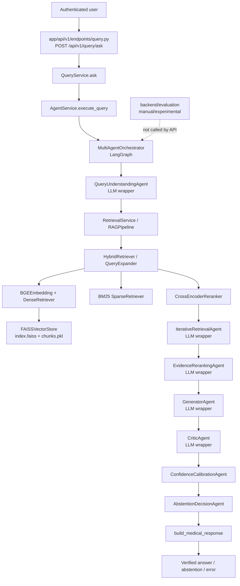
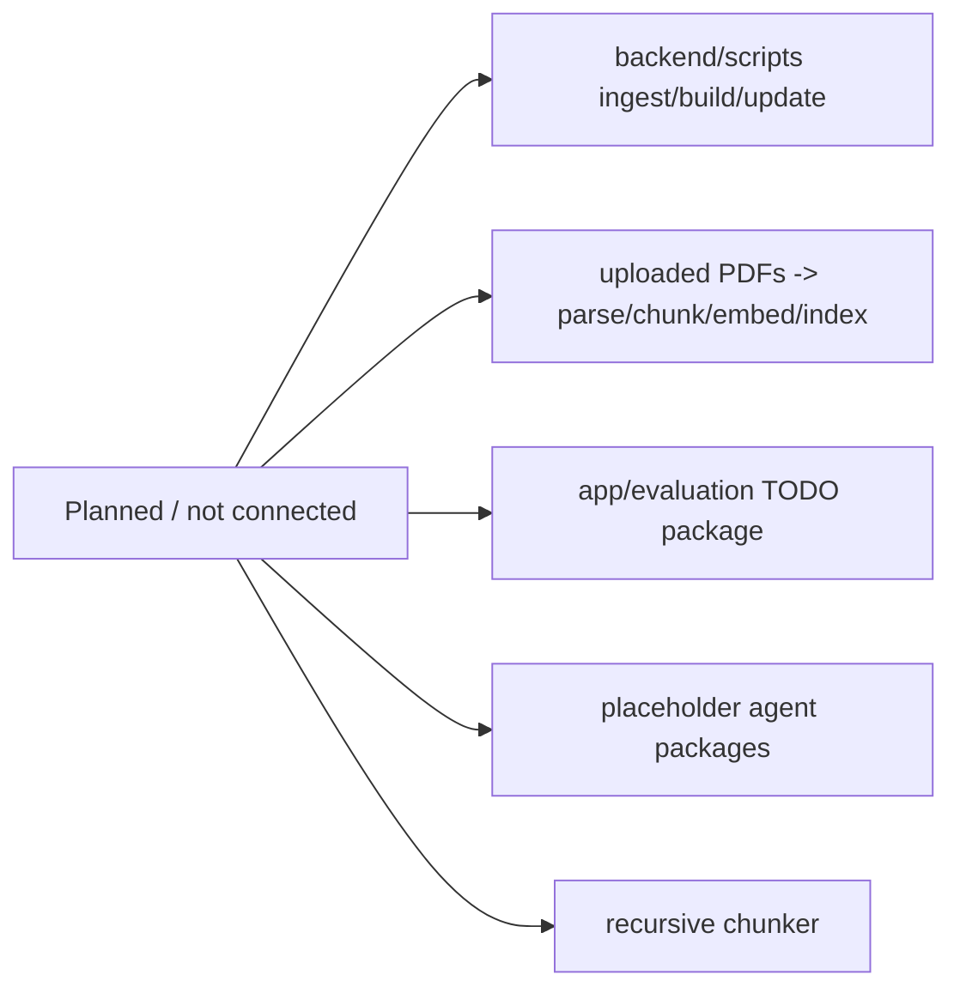

# RAGMedX-MA Codebase Audit

**Audit scope and method.** This is a read-only audit of the code present in this checkout on 2026-09-25. Application code was not changed. “Used” means traceable from the mounted FastAPI application (`backend/app/main.py`) unless stated otherwise. “NOT VERIFIED” means the repository does not provide enough evidence. In particular, no benchmark result artifact is tracked, and tests could not be executed in this environment because `python` is not available on `PATH`.

**Most important finding:** the default question API is wired to a multi-agent graph, but it constructs `LocalLLMWrapper(use_mock_fallback=True)`. That constructor selects **explicit MOCK mode**, not local GPU inference. It also uses an empty retrieval facade when `backend/data/faiss_index/index.faiss` and `chunks.pkl` are absent. This checkout has only `.gitkeep` in `backend/data/faiss_index`; the committed FAISS test indexes are under `backend/data/vectorstore/*_test`, which the default service does not load. Therefore a normal default deployment is expected to abstain rather than perform real RAG. A real LLM and a built index can be injected/built for tests or an evaluation run, but the default API wiring does not do that.

## 1. What this project does

RAGMedX-MA is a Python/FastAPI medical-question-answering prototype. A user sends an authenticated question to `/api/v1/query/ask`. The request goes to a LangGraph workflow that first asks an LLM to interpret the question, then asks the retrieval service for evidence, then checks the evidence, generates an answer, critiques it, calculates a confidence score, and either returns an answer or abstains.

The retrieval implementation, when a FAISS index is available, expands the query deterministically, searches both dense vectors and BM25 keywords, fuses the results, and cross-encoder-reranks the evidence. The generator receives formatted evidence and is instructed to use it. The graph has seven concrete agent classes, five of which call the LLM on the normal successful path. The current default path is not a demonstrated real medical RAG deployment: its default LLM mode is mock, and its configured default FAISS index is not present in this checkout.

### How I should explain this project to someone in 60 seconds

“RAGMedX-MA is an experimental medical QA backend. RAG means it should look up evidence from a document index before asking a language model to write an answer. In this repository, the intended lookup stack is BGE-M3 embeddings plus FAISS, BM25 keyword search, reciprocal-rank fusion, and a cross-encoder reranker. A LangGraph workflow adds question interpretation, evidence-sufficiency checking, a critic, confidence scoring, and a final abstain-or-proceed rule. The engineering question is whether those extra stages improve quality enough to justify their latency and complexity. The code contains a real-looking retrieval and agent implementation, but the default API currently starts in mock LLM mode and has no default persisted FAISS index, so a reproducible, measured real baseline has not been established. The repository itself does not provide evidence of a novel difference from published papers; that comparison is **NOT VERIFIED** and requires a literature review, not code inspection.”

### How I should explain this project in 5 minutes

1. Start with the goal: answer medical questions using retrieved material rather than asking a model to answer from memory alone.
2. Explain the entry point: FastAPI creates the application in `backend/app/main.py`, mounts `/api/v1`, and `/api/v1/query/ask` calls `QueryService`, then `AgentService`.
3. Explain retrieval: an available index is loaded from `backend/data/faiss_index`; BGE-M3 embeds the query, FAISS finds vector-near chunks, BM25 finds lexical matches, RRF fuses lists, and BGE reranker v2 M3 selects the final evidence.
4. Explain the graph: query understanding → retrieval → evidence gap analysis (up to three retrieval passes) → evidence reranking/contradiction check → answer generation → critic (with at most one revision) → deterministic confidence → deterministic abstention decision.
5. Explain the safety behavior: no evidence, contradicted evidence, model failure, or low confidence leads to an abstention response rather than a normal answer.
6. Explain the important limitation honestly: the normal API creates an explicit mock wrapper and no usable default index is tracked, so the demonstrated default is a safety/flow prototype, not proof of real clinical-answer quality.
7. Explain the research plan: first build a fixed corpus and question/evidence dataset; benchmark LLM-only and basic RAG; then add one component at a time and measure answer quality, retrieval quality, faithfulness, latency, and cost.

## Repository Structure

```text
Ragmed_2/
├── backend/
│   ├── app/
│   │   ├── main.py                       FastAPI application factory and mounted API
│   │   ├── api/v1/                       mounted authenticated query, auth, chat, documents routes
│   │   ├── services/                     request-to-pipeline service boundaries
│   │   ├── agents/                       LangGraph workflow and seven concrete agents
│   │   ├── rag/                          canonical retrieval, chunking, loaders, FAISS, citations
│   │   ├── retrieval/                    compatibility exports plus unified loader
│   │   ├── llm/                          local/mock Transformers wrapper and prompts
│   │   ├── evaluation/                   placeholder package; not the active evaluator
│   │   ├── schemas/ and db/              API models, auth, conversations, SQLite ORM
│   ├── evaluation/                       actual metric functions, MedQA index builder, benchmark scaffold
│   ├── prompts/v1/                       prompt files used by agent prompt rendering
│   ├── scripts/                          four one-line ingestion/index placeholders
│   ├── tests/                            component, API, graph, retrieval, and integration tests
│   ├── data/                             empty configured FAISS location; test indexes elsewhere
│   └── .env.example                      only DEBUG template; no model/index runtime settings
├── frontend/src/App.tsx                  frontend exists; UI-to-query wiring NOT VERIFIED here
└── docs/                                 project documents and this audit
```

### Important Files At A Glance

| File | Purpose | Important functions/classes | Used by | Status |
|---|---|---|---|---|
| `backend/app/main.py` | Creates FastAPI and mounts the v1 router. | `create_app`, `app` | ASGI server | IMPLEMENTED AND USED |
| `backend/app/api/v1/endpoints/query.py` | Defines authenticated medical QA endpoint. | `ask_medical_question` | v1 router | IMPLEMENTED AND USED |
| `backend/app/services/query_service.py` | Delegates API request to agent service. | `QueryService.ask` | query endpoint | IMPLEMENTED AND USED |
| `backend/app/services/agent_service.py` | Public service boundary for graph execution. | `AgentService.execute_query` | QueryService | IMPLEMENTED AND USED |
| `backend/app/agents/__init__.py` | Creates state, orchestrator, and API response. | `run_agent_pipeline` | AgentService/evaluators | IMPLEMENTED AND USED |
| `backend/app/agents/orchestrator.py` | Compiles and runs the LangGraph state machine. | `MultiAgentOrchestrator` | run_agent_pipeline | IMPLEMENTED AND USED |
| `backend/app/services/retrieval_service.py` | Builds retrieval facade and exposes evidence callable. | `RetrievalService.build` | orchestrator default | IMPLEMENTED AND USED |
| `backend/app/rag/pipeline.py` | Composes retrieval and converts results to agent evidence. | `RAGPipeline`, `RAGRetrievalPipeline` | RetrievalService/evaluation | IMPLEMENTED AND USED |
| `backend/app/rag/retrievers/hybrid_retriever.py` | Query expansion, dense/BM25 search, RRF. | `HybridRetriever.retrieve` | RAGPipeline | IMPLEMENTED AND USED |
| `backend/app/rag/embeddings/bge_embedding.py` | Loads BGE-M3 and embeds documents/queries. | `BGEEmbedding` | dense retriever/index builder | IMPLEMENTED AND USED |
| `backend/app/rag/vectorstore/faiss_store.py` | FAISS persistence and similarity search. | `FAISSVectorStore` | RAGPipeline/index builder | IMPLEMENTED AND USED |
| `backend/app/llm/local_llm.py` | Transformer local or mock inference wrapper. | `LocalLLMWrapper.generate` | LLM-using agents | IMPLEMENTED AND USED |
| `backend/evaluation/index_builder.py` | Builds a MedQA-only FAISS index via CLI/API. | `MedQAIndexBuilder` | MIRAGE runner/tests | EXPERIMENTAL |
| `backend/evaluation/mirage_runner.py` | Runs a scaffold or RAG-aware evaluation in memory. | `BenchmarkRunner` | tests/manual caller | EXPERIMENTAL |
| `backend/app/rag/chunking/semantic_chunker.py` | Cleans and splits `MedicalDocument`s. | `MedicalChunker` | tests; not default index builder | IMPLEMENTED BUT NOT CONNECTED |
| `backend/scripts/*.py` | Named ingestion/index scripts. | none | none | PARTIALLY IMPLEMENTED |
| `backend/app/retrieval/*.py` | Compatibility exports; `DocumentLoader` is an alternate loader boundary. | `DocumentLoader` | mostly tests/import API | IMPLEMENTED BUT NOT CONNECTED |
| `backend/app/evaluation/*.py` | Future evaluation package. | none | none | PARTIALLY IMPLEMENTED |

## Actual Entry Point and Call Chain

**ASGI entry module:** `backend/app/main.py:20` (`create_app`), with module-level `app` at line 33. It imports and mounts `app.api.v1.router.api_router` under `/api/v1` (line 24).

**Actual question route:** `POST /api/v1/query/ask`, `backend/app/api/v1/endpoints/query.py:13`, `ask_medical_question`. It requires `get_current_user`; unauthenticated calls are tested as 401. The older `backend/app/api/router.py` and `backend/app/api/routes/chat.py` are **not mounted by `main.py`**. In addition, that older route calls a nonexistent `ChatService.generate_response`, so it is stale/unusable as written.

```text
Authenticated user
  ↓ POST /api/v1/query/ask
app/api/v1/endpoints/query.py:ask_medical_question()
  ↓
app/services/query_service.py:QueryService.ask()
  ↓
app/services/agent_service.py:AgentService.execute_query()
  ↓
app/agents/__init__.py:run_agent_pipeline()
  ↓
app/agents/orchestrator.py:MultiAgentOrchestrator.run()
  ↓ LangGraph nodes
query_understanding → retrieval → gap_analysis → evidence_reranking
→ generator → critic [→ generator/critic once more if revision] → confidence → abstention
  ↓
app/agents/response_builder.py:build_medical_response()
  ↓
MedicalResponse returned by FastAPI
```

## End-to-End Pipeline

### Step 1 — User sends query

- **File/function:** `backend/app/api/v1/endpoints/query.py:ask_medical_question`.
- **Input:** `MedicalQueryRequest`, including `question`, optional `conversation_id`, and `include_agent_trace`.
- **What happens:** authenticated user dependency is resolved; the endpoint creates `QueryService` and awaits `ask`.

### Step 2 — Query preprocessing

- **File/function:** `backend/app/agents/query_understanding.py:QueryUnderstandingAgent.run`, reached by orchestrator node `_node_query_understanding`.
- **What happens:** `render_prompt("query_understanding", {"question": ...})` renders `backend/prompts/v1/query_understanding.txt` when present. The LLM is asked for specialty, intent, abbreviations, expanded query, and confidence. The graph passes the `expanded_query` to retrieval as `optimized_query`.
- **Limitation:** if query understanding fails, state records an error but the graph still enters retrieval; it does not stop immediately.

### Step 3 — Query embedding

- **Files/functions:** `backend/app/rag/retrievers/dense_retriever.py:DenseRetriever.retrieve` calls `BGEEmbedding.embed_query`; `backend/app/rag/embeddings/bge_embedding.py:BGEEmbedding.embed` runs the model.
- **Model:** `BAAI/bge-m3`, max input length 512, mean pooled and L2-normalized.
- **When:** only when `RAGPipeline.build` finds a default index and successfully loads all retrieval models. Otherwise no query embedding occurs.

### Step 4 — Vector retrieval

- **Files/functions:** `HybridRetriever.retrieve` calls dense and sparse retrieval for each expanded query. Dense invokes `FAISSVectorStore.search`; sparse runs in-process BM25; `_fuse_results` performs RRF; `RAGRetrievalPipeline.retrieve` then calls `CrossEncoderReranker.rerank`.
- **Vector database:** FAISS `IndexFlatIP`, configured in `FAISSVectorStore`.
- **Metric:** inner product; documented equivalent to cosine because BGE embeddings are normalized.
- **Top-k:** runtime build defaults are 20 candidate results and 5 final results (`RetrievalService.build` / `RAGPipeline.build`); `HybridRetriever` defaults per subsearch to at least 10. There are other unused configuration constants, so do not treat them as live route configuration.
- **Filters:** no metadata filter in this execution path.

### Step 5 — Retrieved context

`MedicalChunk` (`backend/app/rag/chunking/models.py`) contains `id`, `document_id`, `content`, optional title/section/journal/year, source, and arbitrary metadata. `RAGPipeline.retrieve_evidence` transforms reranked chunks into dictionaries with text, normalized relevance score, raw cross-encoder logit, citation marker, journal/year/DOI/URL fields. It uses `CitationGenerator` for response-visible markers.

### Step 6 — Prompt construction

- **Central renderer:** `backend/app/llm/prompt_templates.py:render_prompt` first tries `backend/prompts/v1/<agent>.txt`, then falls back to in-code Jinja templates.
- **Question/context insertion:** Query, gap, evidence reranking, generator, and critic each insert the original question. Gap, evidence reranking, generator, and critic format evidence into their prompts. Generator explicitly says to answer only from evidence; critic requests JSON checks.
- **System prompt:** agent calls do not pass `system_prompt` to `LocalLLMWrapper.generate`; the wrapper supports it but this pipeline uses a single rendered prompt argument.

### Step 7 — LLM generation

- **File/function:** `backend/app/llm/local_llm.py:LocalLLMWrapper.generate`.
- **Default pipeline model/mode:** `MultiAgentOrchestrator.__init__` constructs `LocalLLMWrapper(use_mock_fallback=True)`. Per wrapper code lines 42–44, this is `MOCK`, with deterministic canned responses, not automatic local-model fallback.
- **Real local option:** default wrapper class model string is `Qwen/Qwen3-8B`, 4-bit NF4 GPU load, `max_context_length=8192`; it supports Qwen2.5/Qwen3/Llama 3.1 paths only as generic wrapper capability. A real wrapper must be injected by a caller. The legacy unmounted chat route reports `Qwen2.5-1.5B`, which conflicts with the mounted pipeline and is not current execution evidence.
- **Parameters:** agents use temperatures 0.0 (query/gap/evidence reranking/critic) or 0.1 (generator); unspecified calls use wrapper defaults max 512 new tokens and top-p 0.95. No retry/timeout logic was found.

### Step 8 — Post-processing

Generator rejects citation markers not present in supplied evidence. Critic calls `EvidenceVerifier` to structurally validate evidence/provenance and checks that answer markers map to evidence spans; it explicitly does **not** prove semantic entailment. Confidence computes a deterministic weighted score. Abstention chooses `PROCEED`/`ABSTAIN` with fixed safety messages. `response_builder.build_medical_response` serializes answer, citations, confidence, trace, and token count.

### Step 9 — Agents

Agents are graph nodes in `MultiAgentOrchestrator._build_graph` (`backend/app/agents/orchestrator.py:98`). There are no parallel graph branches.

### Step 10 — Final API response

`build_medical_response` returns `VerifiedAnswerResponse`, `AbstentionResponse`, or `ErrorResponse`. `QueryService.ask` returns it to the endpoint; FastAPI serializes it as `MedicalResponse`.

## Basic RAG Architecture

Normal RAG is: **documents → load → chunk → embed → vector index → retrieve → give context to LLM → answer**.

| RAG Stage | Actual File | Actual Function/Class | Model/Technology | Status |
|---|---|---|---|---|
| Document loading | `app/rag/loaders/*`, `app/retrieval/document_loader.py` | `PubMedLoader`, `PMCLoader`, `BioASQLoader`, `MedQALoader`, `DocumentLoader` | XML/gzip JSON/JSONL/PDF/text parsers | IMPLEMENTED BUT NOT CONNECTED |
| Cleaning | `app/rag/chunking/semantic_chunker.py` | `MedicalChunker._clean_text`, `_remove_article_end_matter` | regex | IMPLEMENTED BUT NOT CONNECTED |
| Chunking | same | `MedicalChunker.chunk_document(s)` | section-aware char chunks | IMPLEMENTED BUT NOT CONNECTED |
| Embedding | `app/rag/embeddings/bge_embedding.py` | `BGEEmbedding.embed_documents` | `BAAI/bge-m3` | IMPLEMENTED AND USED by experimental builder |
| Vector storage | `app/rag/vectorstore/faiss_store.py` | `FAISSVectorStore.add/save/load` | FAISS `IndexFlatIP`, pickle metadata | IMPLEMENTED AND USED when index exists |
| Query embedding | `app/rag/retrievers/dense_retriever.py` | `DenseRetriever.retrieve` | BGE-M3 | IMPLEMENTED AND USED when ready |
| Retrieval | `app/rag/retrievers/hybrid_retriever.py` | `HybridRetriever.retrieve` | dense + BM25 + RRF | IMPLEMENTED AND USED when ready |
| Context construction | `app/rag/pipeline.py` | `RAGPipeline.retrieve_evidence` | evidence dicts/citation generator | IMPLEMENTED AND USED when ready |
| Prompt | `app/agents/generator.py`, `app/llm/prompt_templates.py` | `_build_prompt`, `render_prompt` | Jinja2/text prompt | IMPLEMENTED AND USED |
| Generation | `app/agents/generator.py` | `GeneratorAgent.run` | `LocalLLMWrapper` | IMPLEMENTED AND USED; default mock |

The practical break is between generic loader/chunker code and production index construction: the only working index builder creates one chunk per **MedQA question**, without calling `MedicalChunker`. PubMed/PMC/BioASQ loaders and chunker are not automatically chained to an index build.

## Document Ingestion

### What exists

- `PubMedLoader` parses `.xml.gz` PubMed baseline articles, extracting title, abstract, journal, publication year, and PMID metadata.
- `PMCLoader` parses PMC BioC XML. **NOT VERIFIED as a connected source**, because its named ingestion script is a one-line placeholder and no caller from the main path was found.
- `BioASQLoader` reads `.json` questions/snippets into `MedicalDocument`s. **Not connected** to `DocumentLoader.load_all`, which discovers only `medqa/`.
- `MedQALoader` accepts `.json` and `.jsonl` file names but iterates line-by-line JSON; array-style `.json` is not evidenced as supported correctly.
- `PDFLoader` outputs page `Document` objects; `TextLoader` outputs one `Document`; `DocumentLoader` converts these to `MedicalDocument`.
- `MedicalChunker` has defaults of 800-character chunks, 100-character overlap, and 150 minimum characters. It cleans whitespace/noise and removes text after reference/end-matter headings. `app/config.py` also defines conflicting 2000/400 and settings 1000/150 values, but they are not wired into `MedicalChunker` in the verified default index build.

### Actual index build path

The only complete persistent build command is:

```powershell
cd backend
python -m evaluation.index_builder --dataset data/datasets/medqa/sample.jsonl --index-dir data/faiss_index
```

This calls `MedQAIndexBuilder.build`: JSONL records → one `MedicalChunk` per record (question text only) → `BGEEmbedding.embed_documents` → `FAISSVectorStore.add` → `index.faiss` plus `chunks.pkl`. Its metadata captures answer/options/meta_info as strings. It does not invoke loaders generally, cleaning, semantic chunking, PubMed, PMC, or uploaded PDFs.

Vectors persist as `index.faiss`; chunk metadata persist as pickle `chunks.pkl`. A BM25 index is rebuilt in memory from loaded FAISS chunks by `RAGPipeline.build`, rather than loaded from the committed `bm25.pkl` test artifact. Ingestion is manual; FastAPI startup creates SQLite tables only. Document upload saves PDF bytes and JSON upload metadata but does not parse, chunk, embed, or add it to FAISS despite its success text saying “ready for retrieval processing.”

## Retrieval System

| Capability | Status | Evidence |
|---|---|---|
| Dense retrieval | IMPLEMENTED | `DenseRetriever` → BGE-M3 → FAISS |
| Vector index | IMPLEMENTED | `FAISSVectorStore`, `IndexFlatIP` |
| Similarity metric | IMPLEMENTED | normalized vectors + inner product/cosine equivalence |
| Sparse keyword retrieval | IMPLEMENTED | `SparseRetriever` custom Okapi BM25 |
| Hybrid fusion | IMPLEMENTED | `HybridRetriever._fuse_results`, RRF `k=60` |
| Deterministic query expansion | IMPLEMENTED | `QueryExpander`, up to four variants |
| LLM query rewriting | PARTIALLY IMPLEMENTED | Query Understanding produces `expanded_query`; retrieval uses it, but it is mock by default |
| Cross-encoder reranking | IMPLEMENTED | `BAAI/bge-reranker-v2-m3` |
| Metadata filtering | NOT IMPLEMENTED | no query filter parameter/path found |
| Retrieval by uploaded file ownership | NOT IMPLEMENTED | uploads never enter index |
| Persisted BM25 loaded in main path | NOT IMPLEMENTED | BM25 rebuilt from FAISS chunk metadata |

For a ready pipeline, retrieval expands the selected query, performs dense then sparse search **sequentially** for every expansion, fuses every list by RRF, reranks the first candidates, and returns final chunks. The graph can repeat retrieval at most three times when the gap agent returns a focused sub-query; it extends the evidence list, then deduplicates by `chunk_id`.

## LLM Implementation

| Component | File | Model | Purpose | Used in main pipeline? |
|---|---|---|---|---|
| `LocalLLMWrapper` | `backend/app/llm/local_llm.py` | default string `Qwen/Qwen3-8B`; mock alternatives | load/generate/count tokens | YES |
| Query agent | `app/agents/query_understanding.py` | wrapper-selected | produce structured retrieval query | YES, mock by default |
| Gap agent | `app/agents/iterative_retrieval.py` | wrapper-selected | assess evidence and optionally sub-query | YES, mock by default |
| Evidence reranking agent | `app/agents/evidence_reranking.py` | wrapper-selected | contradiction/selection judgement | YES, mock by default |
| Generator | `app/agents/generator.py` | wrapper-selected | grounded answer | YES, mock by default |
| Critic | `app/agents/critic.py` | wrapper-selected | score answer/evidence | YES, mock by default |
| Cross encoder | `app/rag/rerankers/cross_encoder_reranker.py` | `BAAI/bge-reranker-v2-m3` | retrieval relevance, not generator LLM | YES when index ready |

No Ollama, OpenAI API, remote provider, timeout, retry policy, or cost accounting implementation was found. `LocalLLMWrapper` returns token usage metadata, but agent/orchestrator code does not add those values to `AgentState.total_tokens_used`; response token totals are therefore not verified as accurate. Real local inference requires CUDA and bitsandbytes; it raises on failure unless configured to permit fallback. The default graph does not select real local mode.

## Multi-Agent Architecture

### Actual implemented agents and connection status

| Agent | File | Class | Purpose / I/O | Called by | Actually used? |
|---|---|---|---|---|---|
| Query Understanding | `agents/query_understanding.py` | `QueryUnderstandingAgent` | question → structured specialty/intent/expanded query | graph query node | YES |
| Medical Gap Analysis | `agents/iterative_retrieval.py` | `IterativeRetrievalAgent` | question + evidence → sufficient flag / sub-query | graph gap node | YES |
| Evidence Re-Ranking | `agents/evidence_reranking.py` | `EvidenceRerankingAgent` | evidence → evidence order/selection + contradiction flag | graph rerank node | YES |
| Medical Answer Generator | `agents/generator.py` | `GeneratorAgent` | question + evidence (+ revision) → cited answer | graph generator node | YES |
| Medical Answer Critic | `agents/critic.py` | `CriticAgent` | question + answer + evidence → verdict/revision | graph critic node | YES |
| Confidence Calibration | `agents/confidence_calibration.py` | `ConfidenceCalibrationAgent` | evidence + critic score → deterministic composite | graph confidence node | YES |
| Abstention Decision | `agents/abstention_decision.py` | `AbstentionDecisionAgent` | calibration + safety flags → proceed/abstain | graph final node | YES |

The retrieval graph node is not a standalone “retrieval agent” class. It calls `RetrievalService.retrieve_evidence`. `agents/retrieval_agent/__init__.py`, `query_agent/__init__.py`, `citation_agent/__init__.py`, `confidence_agent/__init__.py`, `hallucination_agent/__init__.py`, and `verification_agent/__init__.py` contain TODO placeholder comments, not implemented agent behavior. Treat them as **planned/orphaned package names**, not active agents.

### Per-agent behavior, costs, tests, and failures

| Agent | LLM calls per visit | Failure behavior | Test evidence |
|---|---:|---|---|
| Query Understanding | 1 | records error; graph still tries retrieval | `test_query_understanding.py`, graph/API tests |
| Gap Analysis | 1 per retrieval pass | marks retrieval failure; goes confidence/abstention | `test_iterative_retrieval.py`, graph tests |
| Evidence Re-Ranking | 1 | marks retrieval failure; skips generator | `test_evidence_reranking.py`, graph tests |
| Generator | 1 per generation round | model failure; response becomes abstention | `test_generator.py`, graph tests |
| Critic | 1 per review round | model failure; response becomes abstention | `test_critic.py`, graph tests |
| Confidence Calibration | 0 | exception would propagate from node; normal implementation is deterministic | `test_confidence_calibration.py` |
| Abstention Decision | 0 | exception would propagate from node; normal implementation is deterministic | `test_abstention_decision.py` |

The rationale is plausible but not validated: query understanding may make retrieval vocabulary clearer; gap analysis may avoid answering from incomplete evidence; reranking may favor evidence and screen contradictions; critic may catch bad drafts; confidence/abstention stop low-confidence output. What is **actual** is the code path. What is **not established** is that any agent improves medical accuracy, faithfulness, latency-adjusted quality, or safety over a simpler RAG system.

### Agent flow and classification

```text
Query
  ↓
Query Understanding (LLM)
  ↓
Retrieval Service (BGE-M3 + FAISS + BM25/RRF + cross encoder when ready)
  ↓
Medical Gap Analysis (LLM)
  ├── insufficient + sub-query: retrieval again (maximum 3 retrieval passes)
  └── sufficient: Evidence Re-Ranking (LLM)
                        ↓
                     Generator (LLM)
                        ↓
                     Critic (LLM)
                        ├── revision requested: Generator then Critic once more
                        └── accepted/rejected: Confidence Calibration (deterministic)
                                                    ↓
                                             Abstention Decision (deterministic)
                                                    ↓
                                              API response
```

**Classification: sequential with bounded loops.** LangGraph edges are serial; no `asyncio.gather`, parallel LangGraph branches, thread pool, or process pool is used. The dense and sparse searches are also called sequentially inside the query-variant loop. Potential parallelism (not implemented) includes independent dense and BM25 calls, and perhaps separate deterministic scoring/formatting after retrieval. Critic cannot begin until generator output exists; generator cannot begin until evidence gating finishes.

## Latency and Cost Analysis

For a normal successful first-pass flow, code calls the wrapper **five times**: query understanding, gap analysis, evidence reranking, generator, critic. Confidence and abstention are deterministic. A one-round generator/critic revision makes seven calls. If gap analysis requests additional passes, each extra pass adds one retrieval call and one LLM gap call, to a cap of three retrieval passes. Default mock mode is fast but does not represent real-model latency.

```text
Total latency ≈
query-understanding LLM
+ [query embedding + dense FAISS + BM25 + RRF + cross-encoder reranking]
+ gap-analysis LLM
+ evidence-reranking LLM
+ generator LLM
+ critic LLM
+ optional (generator LLM + critic LLM)
+ deterministic confidence/abstention/serialization
```

The expensive real components are BGE embedding, cross-encoder scoring, and each local LLM inference. The most likely structural bottleneck is sequential LLM calls, but **actual component latency is NOT MEASURED in a committed result**. The MIRAGE runner measures wall-clock per sample in code; that is not evidence that a benchmark was run. It also retrieves once for tracing and then asks the graph to retrieve again, so its `run_rag_evaluation` path deliberately performs duplicate retrieval per evaluated sample.

Reasonable future optimizations to test, not claims of current behavior: cache query embeddings/results; parallelize dense and BM25 searches; avoid LLM agents for deterministic work; conditionally invoke critic or validation; reduce candidate count; use small task-specific models for classification; batch embeddings/reranking; and early-abstain on clearly empty retrieval.

## Failure Analysis

### A. Retrieval failure

If the index is missing/not loadable, `RAGPipeline.build` silently returns an empty facade. If retrieval returns no evidence, gap analysis is skipped, `retrieval_failure` is set, and confidence plus abstention return “No relevant medical literature found.” Incorrect but non-empty evidence has no direct ground-truth relevance test at runtime. Relevant risks visible in code are corpus quality/missing documents, the disconnected generic ingestion route, chunking configuration inconsistency, BGE/model behavior, query reformulation, top-k, and no metadata filters. Bad metadata generally affects provenance/display rather than current filtering, because filtering is absent.

### B. Generation failure despite correct evidence

The generator prompt restricts use to supplied evidence and rejects unknown citation markers. The critic asks an LLM to score factual consistency/citation support/hallucination risk, and deterministic validation makes sure cited markers map to supplied evidence. It can request one revision or force abstention. This is structural citation/provenance protection, **not a verified semantic-faithfulness guarantee**: the critic’s semantic judgment is itself an LLM output and default mode is mock.

### C. Evidence insufficiency

Gap analysis can report `sufficient=false` and issue a sub-query. The graph repeats retrieval up to three passes. If no sub-query, repeated insufficiency, or a cap is reached, it abstains. It does not independently calculate evidence completeness from retrieval scores.

### D. Ambiguous query

Query Understanding asks for intent, specialty, abbreviation resolution and an expanded query. This is the intended handling. There is no verified interactive clarification question; the system either retrieves with its generated expansion or eventually abstains.

### E. Hallucination

The code detects invalid citation markers, missing evidence/provenance, critic-assigned hallucination risk, contradiction flag, and low confidence. It does **not** implement an independent entailment model, claim-level evidence alignment, or human review. Therefore unsupported uncited claims can still evade a correct detection guarantee.

## Should We Change the Model?

No—not as the first conclusion. A larger model may help generation, but cannot fix an absent index, unsuitable corpus, failed retrieval, or a weak evaluation design. The code offers no measured comparison that justifies a model change.

```text
Wrong answer
  ↓
Was relevant evidence retrieved?
  ├── No → inspect corpus, ingestion/chunking, BGE embeddings, top-k,
  │        deterministic expansion, RRF/reranking, and query formulation.
  └── Yes
       ↓
Did the model use evidence correctly?
  ├── No → inspect prompt/context formatting, citation checks, temperature,
  │        context limits, then compare models under the same conditions.
  └── Yes
       ↓
Is the evidence itself incomplete or unsuitable?
  ├── Yes → improve corpus/retrieval/context strategy.
  └── No → inspect labels, evaluation design, and other pipeline defects.
```

Model replacement should be an experiment with unchanged corpus, retrieval setup, prompts as appropriate, fixed questions, and reported accuracy/faithfulness/latency/cost—not an assumption.

## Current Evaluation and Benchmarking

| Metric | Already implemented? | Where/how measured | Missing / caveat |
|---|---|---|---|
| Accuracy | YES, function only | `evaluation/metrics.py:compute_accuracy`; normalized substring match | no committed real result; not robust free-text clinical accuracy |
| Exact Match | NO | — | missing |
| F1 | NO | — | missing |
| Recall@K | YES, function only | `compute_recall_at_k` with supplied IDs/sets | runner does not calculate it on a relevance dataset |
| Precision@K | YES, function only | `compute_precision_at_k` | same caveat |
| MRR | NO | — | missing |
| NDCG | NO | — | missing |
| Faithfulness | NO | critic gives LLM heuristic signals; not a metric | missing validated measure |
| Answer relevance | NO | — | missing |
| Retrieval coverage | YES, weak proxy | keyword overlap in `compute_retrieval_coverage` | not judged relevance / Recall@K |
| Citation support rate | YES | counts presence of citations/markers | not semantic support |
| Abstention rate | YES | response type/status count | no selective-risk analysis |
| Latency | YES, code only | aggregate ms and per sample wall-clock in MIRAGE runner | no committed benchmark result or p95/component breakdown |
| Token usage | PARTIALLY IMPLEMENTED | wrapper returns usage dictionary | graph does not aggregate it into response |
| Cost | NO | — | missing |
| Calibration | PARTIALLY IMPLEMENTED | deterministic confidence formula | no calibration evaluation (ECE/Brier/selective risk) |

**Datasets:** loaders support MedQA, BioASQ, PubMed, PMC, PDF, and text in various forms. The only concrete committed corpus fixture found is `backend/tests/fixtures/pubmed_hypertension_seed.jsonl` (five records). The test/evaluator code refers to `backend/data/datasets/medqa/sample.jsonl`; its availability as a tracked repository dataset is **NOT VERIFIED** from the file inventory, which showed only a `.gitkeep` under data datasets. `run_mirage_pilot.py` is untracked working-tree code, so it is not treated as stable baseline evidence.

**Benchmark status:** `BenchmarkRunner.run_evaluation` clearly labels its output `COMPLETED_MOCK_SCAFFOLD`. `run_rag_evaluation` can construct a temporary MedQA index and run the full graph, but no saved output/report and no completed run were found. Thus **accuracy, retrieval quality, latency, token usage, cost, and faithfulness are not currently benchmarked by repository evidence.**

## Baseline RAG

**BASELINE NOT YET ESTABLISHED.**

There is a usable retrieval composition (`RAGPipeline`) and a MedQA index builder, but not a clean independently runnable baseline that is: fixed-corpus → reproducibly ingested/chunked → basic retrieve-and-generate without agents → evaluated on a separate labelled test set → saved/reportable. The only public `run_agent_pipeline` always creates the multi-agent graph. The index builder uses questions as their own corpus, which risks evaluation leakage unless a proper separated corpus/question protocol is defined. The default server has mock LLM plus no default index. Results are returned in-memory by runner methods, not saved by a committed result writer.

Before calling anything a baseline, define a fixed corpus, train/dev/test or held-out evaluation protocol, one actual generation model/mode, index build command, exact chunking parameters, embedding/reranker settings, retrieval top-k, prompt, and result artifact location. Then run it before adding agents.

## What Should Be Done Before Adding More Agents?

| Experiment | Change | Hold constant | Measure | Hypothesis / improvement criterion | Trade-offs |
|---|---|---|---|---|---|
| 0: LLM only | no retrieval | model, question set, answer format | accuracy, safety, latency, tokens/cost | establishes no-RAG reference | hallucination vs speed |
| 1: Basic RAG | fixed corpus, dense retrieval, one generator | dataset/model/prompt budget | answer accuracy, Recall@K, faithfulness, latency | retrieval improves relevant grounded answers | indexing/inference latency |
| 2: Improved retrieval | add BM25/RRF/reranker/query expander one at a time | baseline generation | Recall/Precision@K, MRR/NDCG, answer results | retrieval gain justifies cost | reranker and multi-query cost |
| 3: Query processing | add Query Understanding | corpus/retrieval/model | retrieval and answer deltas | reformulated queries help ambiguous terms | one LLM call/latency |
| 4: Evidence validation | add evidence reranking/critic checks | earlier best configuration | faithfulness, citation correctness, abstention precision | fewer unsafe unsupported answers | false abstentions/extra calls |
| 5: Confidence calibration | add confidence/abstention | prior configuration | ECE/Brier/selective risk/coverage | confidence predicts correctness | reduced answer coverage |
| 6: Full graph | all current nodes | benchmark protocol | all metrics and error categories | net benefit over simpler best system | maximum latency/cost/complexity |

### Ablation study template

| Configuration | Accuracy | Retrieval Quality | Faithfulness | Latency | Cost | Purpose |
|---|---|---|---|---|---|---|
| LLM only | TO MEASURE | TO MEASURE | TO MEASURE | TO MEASURE | TO MEASURE | no-RAG reference |
| Basic RAG | TO MEASURE | TO MEASURE | TO MEASURE | TO MEASURE | TO MEASURE | primary baseline |
| RAG + Query Understanding | TO MEASURE | TO MEASURE | TO MEASURE | TO MEASURE | TO MEASURE | query-processing value |
| RAG + Evidence Re-Ranking | TO MEASURE | TO MEASURE | TO MEASURE | TO MEASURE | TO MEASURE | evidence-selection value |
| RAG + Critic/Validation | TO MEASURE | TO MEASURE | TO MEASURE | TO MEASURE | TO MEASURE | generation-safety value |
| RAG + Confidence/Abstention | TO MEASURE | TO MEASURE | TO MEASURE | TO MEASURE | TO MEASURE | calibrated selective answering |
| Full Multi-Agent RAG | TO MEASURE | TO MEASURE | TO MEASURE | TO MEASURE | TO MEASURE | total system value |

Each configuration must use the same held-out questions and report uncertainty/sample counts. An agent earns its complexity only if it produces a meaningful, reproducible benefit at an acceptable latency/cost/coverage trade-off.

## Testing Audit

| Test File(s) | What it tests | Unit/Integration/E2E | Current status |
|---|---|---|---|
| `test_query_understanding`, `test_iterative_retrieval`, `test_evidence_reranking`, `test_generator`, `test_critic`, `test_confidence_calibration`, `test_abstention_decision` | individual agent contracts | unit | present; not run in this audit |
| `test_orchestrator.py` | graph happy path, loop caps, abstention, traces | integration with fake LLM/retriever | present; not run |
| `test_api_query_integration.py` | mounted `/api/v1/query/ask`, auth/schema/serialization | API integration | present; internally does not inject its constructed fake into route service, so successful real-agent behavior is not fully established by this file |
| `test_langgraph_real_seed_integration.py` | real BGE/FAISS/BM25/reranker against five PubMed records and deterministic LLM | marked integration | present; not run; generator LLM is fake |
| `test_native_retrieval_integration.py`, `test_rag_pipeline_facade.py` | native retrieval/service boundary | integration | present; not run |
| `test_bge_embedding`, `test_dense_retriever`, `test_sparse_retriever`, `test_hybrid_retriever`, `test_cross_encoder_reranker`, `test_faiss_store` | retrieval components | unit/integration depending model download | present; not run |
| loader/chunker tests | parser/chunk behavior | unit | present; not run |
| `test_evaluation.py`, `test_mirage_evaluation.py` | metric functions, scaffold and RAG evaluation protocol | unit/integration | present; not run; does not prove a completed benchmark artifact |
| `run_local_llm_diabetes_test.py`, `run_real_gpu_test.py` | manual runtime scripts | manual test scripts | present; not pytest evidence |

No verified test runs occurred here because the current shell reports no Python executable. Important untested-by-evidence areas: real default API with a real LLM and real default index; uploaded PDF → index → retrieved answer; true clinical answer correctness; separate-corpus retrieval relevance; cost; semantic faithfulness; and frontend end-to-end use.

## Configuration and Environment

- `backend/app/config.py` loads `backend/.env` and exposes `DEBUG`, API prefix, SQLite `DATABASE_URL`, CORS origins, uploads path/limit, retrieval data/collection fields, chunk/top-k fields, and `EMBEDDING_MODEL_NAME`. Only variable names are reported here; secrets are intentionally omitted.
- `backend/.env.example` and root `.env.example` only contain `DEBUG=false`; they do not document model path, FAISS index directory, provider, or production deployment settings.
- Several declared values are not live configuration of canonical RAG: `FAISS_INDEX_DIR` is used; `CHUNK_SIZE`, `CHUNK_OVERLAP`, and settings retrieval chunk values are not traced into the current `MedQAIndexBuilder`/`MedicalChunker` route.
- Database defaults to local SQLite. Development/production separation is not implemented beyond `DEBUG`/CORS defaults. Real model runtime is selected by wrapper arguments, not settings.

## Development Evolution (Git evidence)

Git history supports this broad sequence, not a claim of production maturity:

1. Initial FastAPI/chat/local LLM commits (`4e046d4`, `c9ad731`).
2. Loaders, BGE embeddings, FAISS, dense retrieval, PMC chunking (`141b233`, `9856bc8`, `e313bb3`, `908c4c5`, `9701ee1`, `308af6e`).
3. BM25, hybrid RRF, cross-encoder reranking/query expansion (`9117a19`, `38af2b3`, `32a5668`, `da42a2e`).
4. Agent classes, response builder, and LangGraph/retrieval integration (`9e88d9e`, `461b4cb`, `0133939`, `b735d89`, `92f2350`, `c4ff9fa`, `75ca1e8`).
5. Evaluation scaffolding/MIRAGE runner and current uncommitted pilot changes. No commit history or artifact proves a completed benchmarked baseline.

## Likely Dead, Duplicate, and Experimental Code

- `backend/app/api/router.py` and `backend/app/api/routes/chat.py` are **likely stale/unmounted**: `main.py` imports only `api.v1.router`; older chat calls absent `ChatService.generate_response`.
- `backend/app/retrieval/` is mostly compatibility re-exports for canonical `app.rag.*`. `DocumentLoader` is implemented but no default ingestion/main-pipeline caller was found.
- `backend/app/rag/chunking/recursive_chunker.py` is a TODO placeholder. `MedicalChunker` is implemented but not used by `MedQAIndexBuilder`/automatic ingestion.
- `backend/scripts/build_index.py`, `ingest_pmc.py`, `ingest_pubmed.py`, and `update_index.py` are one-line placeholders. Do not use their filenames as evidence of a working CLI.
- `backend/app/evaluation/` is all TODO placeholders; the active evaluation code lives in `backend/evaluation/`.
- Placeholder `agents/*_agent/__init__.py` packages are not concrete agents; several overlap names of actual module classes.
- `backend/data/vectorstore/dense_test` and `pmc_test` are test artifacts, not the configured production index directory.
- `backend/evaluation/run_mirage_pilot.py`, `backend/tests/test_evidence_reranking.py`, and related files are uncommitted working-tree changes. They may be valuable, but are experimental/local until committed and reproducibly run.
- README describes a multi-agent iterative framework at a high level. It does not disclose the default mock runtime or absent configured index. Where it conflicts with code, code is the current implementation.

## Current Architecture Diagram





## File-by-File Explanation

### Tier 1 — MUST UNDERSTAND

### `backend/app/main.py`

Purpose: creates the mounted FastAPI service. Important functions: `create_app()` and `lifespan()`. Called by: ASGI server. Calls: v1 router/SQLite setup. Data in/out: HTTP application; no RAG logic. Main pipeline: YES, entry.

### `backend/app/api/v1/endpoints/query.py`

Purpose: receives the authenticated medical question. Important function: `ask_medical_question()`. Called by: FastAPI route matching. Calls: `QueryService.ask`. Data: `MedicalQueryRequest`; output: `MedicalResponse`. Main pipeline: YES.

### `backend/app/services/agent_service.py` and `backend/app/agents/__init__.py`

Purpose: service/pipeline boundary. Important functions: `AgentService.execute_query()` and `run_agent_pipeline()`. They create `AgentState`, create the orchestrator, run it, then build response. Main pipeline: YES.

### `backend/app/agents/orchestrator.py`

Purpose: actual multi-agent control flow. Important class: `MultiAgentOrchestrator`; key methods: `_build_graph`, `_retrieve_evidence_pass`, `_route_after_*`, `run`. Called by: `run_agent_pipeline`. Calls: every active agent plus retrieval service. Data: `AgentState` in/out. Main pipeline: YES.

### `backend/app/services/retrieval_service.py` and `backend/app/rag/pipeline.py`

Purpose: build/load and invoke retrieval. Important classes: `RetrievalService`, `RAGPipeline`, `RAGRetrievalPipeline`. Called by: orchestrator retrieval node. Calls: FAISS, BGE, BM25, cross encoder when index loads. Data: query → evidence dictionaries. Main pipeline: YES, but degraded if no configured index.

### `backend/app/rag/retrievers/hybrid_retriever.py`

Purpose: the retrieval algorithm. Important method: `HybridRetriever.retrieve`. Called by: `RAGRetrievalPipeline`. Calls: query expansion, dense/sparse retrieval, RRF, optionally reranker. Main pipeline: YES when ready.

### `backend/app/rag/embeddings/bge_embedding.py` and `backend/app/rag/vectorstore/faiss_store.py`

Purpose: create vectors and persist/search them. Important: `BGEEmbedding.embed_query/embed_documents`, `FAISSVectorStore.add/search/save/load`. Called by: dense retriever/index builder. Main pipeline: YES when ready.

### `backend/app/llm/local_llm.py`

Purpose: model runtime boundary. Important: `LocalLLMWrapper.load_model/generate`. Called by five agent classes. Outputs text and a token-usage dict. Main pipeline: YES; defaults mock.

### `backend/app/agents/{query_understanding,iterative_retrieval,evidence_reranking,generator,critic,confidence_calibration,abstention_decision}.py`

Purpose: seven actual workflow stages described above. Called by: orchestrator nodes. Main pipeline: YES. Read these after the orchestrator to understand each stage’s contract.

### `backend/app/agents/response_builder.py`

Purpose: converts internal state to public response schemas. Important: `build_medical_response`. Called by: `run_agent_pipeline`. Main pipeline: YES.

### Tier 2 — SHOULD UNDERSTAND

- `backend/app/agents/state.py`: Pydantic state/contracts and workflow flags.
- `backend/app/llm/prompt_templates.py` plus `backend/prompts/v1/*.txt`: exact prompt selection/rendering.
- `backend/app/rag/retrievers/dense_retriever.py`, `sparse_retriever.py`, `query_expander.py`, and `rerankers/cross_encoder_reranker.py`: retrieval details.
- `backend/evaluation/index_builder.py`, `metrics.py`, and `mirage_runner.py`: available benchmark scaffolding.
- `backend/app/rag/chunking/semantic_chunker.py` and loaders: intended ingestion components, currently disconnected.
- `backend/app/services/document_service.py`: upload persistence only, not RAG ingestion.

### Tier 3 — CAN IGNORE FOR NOW

- `backend/app/api/router.py` and `api/routes/*` legacy/unmounted routes.
- `backend/app/retrieval/` re-export wrappers, unless working on compatibility/import cleanup.
- `backend/app/evaluation/` placeholders.
- named placeholder agent packages, scripts placeholders, recursive chunker, and broad project docs until runtime behavior is understood.

## If I Only Read 10 Files

1. `backend/app/main.py` — see what is actually mounted; next read v1 router.
2. `backend/app/api/v1/router.py` — see route registration; next read query endpoint.
3. `backend/app/api/v1/endpoints/query.py` — see the real question route; next read QueryService.
4. `backend/app/services/query_service.py` — see service delegation; next read AgentService.
5. `backend/app/services/agent_service.py` — see public graph call; next read agents package initializer.
6. `backend/app/agents/__init__.py` — see state/orchestrator/response boundary; next read orchestrator.
7. `backend/app/agents/orchestrator.py` — understand all actual paths and loops; next read retrieval facade.
8. `backend/app/rag/pipeline.py` — understand when retrieval is ready and how evidence is shaped; next read hybrid retriever.
9. `backend/app/rag/retrievers/hybrid_retriever.py` — understand search behavior; next read LLM wrapper.
10. `backend/app/llm/local_llm.py` — discover the crucial mock/local runtime behavior; then read active agent modules and prompts.

## Follow One Query Through the Code

Put the first breakpoint at `backend/app/api/v1/endpoints/query.py:14`, `ask_medical_question`.

1. Step into `backend/app/services/query_service.py:13`, `QueryService.ask`.
2. Step into `backend/app/services/agent_service.py:23`, `AgentService.execute_query`.
3. Step into `backend/app/agents/__init__.py:14`, `run_agent_pipeline`; inspect constructed `AgentState`.
4. Step into `backend/app/agents/orchestrator.py:75`, `MultiAgentOrchestrator.run`; inspect `self.llm_wrapper.active_runtime_mode` and `self.retrieval_service.is_ready`.
5. At `_node_query_understanding` / `QueryUnderstandingAgent.run`, inspect rendered prompt and mock/local response.
6. At `_retrieve_evidence_pass` line 406, inspect `optimized_query`, then step into `RetrievalService.retrieve_evidence` and `RAGPipeline.retrieve_evidence`.
7. If ready, step through `RAGRetrievalPipeline.retrieve` → `HybridRetriever.retrieve` → `DenseRetriever.retrieve` → `FAISSVectorStore.search`; inspect returned chunks and scores.
8. Follow graph nodes through gap analysis, evidence reranking, generator, critic, confidence, abstention. Watch `retrieval_failure`, `contradictory_evidence`, `model_failure`, `critic_round_count`, and `total_tokens_used`.
9. Finally step into `response_builder.build_medical_response` and inspect whether it returns `VerifiedAnswerResponse` or `AbstentionResponse`.

## Research Gaps

### Already implemented

FastAPI query route; LangGraph state machine; BGE-M3/FAISS/BM25/RRF/cross-encoder retrieval implementation; five LLM-using stages; deterministic confidence and abstention; metric utility functions; unit/integration test files.

### Partially implemented

Real local model support; evaluator/MedQA builder; semantic chunker/loaders; citation/provenance validation; upload lifecycle; token reporting.

### Implemented but not evaluated

Hybrid retrieval, query expansion/rewrite, reranking, seven-stage graph, critic/revision, evidence ranking, confidence/abstention. Their utility is not demonstrated by a stored benchmark result.

### Planned but not implemented

Generic ingestion CLIs, uploaded document indexing, recursive chunking, v1 evaluation endpoints/services, evaluation registry/tracking, several named agent package modules, metadata filtering, cost accounting, retry/timeouts, and frontend integration verification.

### Missing for a strong experimental evaluation

A real corpus build protocol; held-out labelled question/evidence set; basic RAG-only runnable baseline; robust answer/retrieval/faithfulness/calibration metrics; saved experiment configurations/results; real local/remote runtime settings; reproducible environment; and comparison/ablation reporting.

## Prioritized Next Steps

1. **Priority 0 — reproduce the current pipeline.** Build the configured index, intentionally select a real or mock runtime, and trace a known query. Without this, behavior is ambiguous.
2. **Priority 1 — establish clean baseline.** Implement/run a documented basic RAG-only configuration conceptually before graph complexity; keep corpus/model/prompt fixed.
3. **Priority 2 — create benchmark data/protocol.** Separate corpus from questions and record relevance/answer labels; avoid MedQA question-as-corpus leakage.
4. **Priority 3 — measure baseline.** Record answer quality, retrieval Recall/Precision@K plus MRR/NDCG, faithfulness, latency percentiles, token counts, cost, and abstention coverage.
5. **Priority 4 — fix observed baseline problems.** Use actual error analysis, not presumed improvements.
6. **Priority 5 — add one current architectural component.** Begin with a component whose failure hypothesis is measurable.
7. **Priority 6 — benchmark it.** Use the same fixed protocol and save results.
8. **Priority 7 — ablate it.** Compare with and without it; analyze latency/cost/coverage.
9. **Priority 8 — only then consider additional agents.** Complexity should follow measured value.

## Questions I Should Be Able To Answer

- [x] Where does the application start? `backend/app/main.py:create_app`.
- [x] What API receives the question? `POST /api/v1/query/ask`.
- [x] Where is the RAG pipeline? `backend/app/rag/pipeline.py`.
- [x] Where is chunking? `backend/app/rag/chunking/semantic_chunker.py`, but disconnected from current builder.
- [x] Where are embeddings created? `BGEEmbedding.embed*`.
- [x] Which embedding model? `BAAI/bge-m3` in canonical RAG.
- [x] Which vector DB? FAISS `IndexFlatIP`.
- [x] How is retrieval performed? dense + BM25 + RRF + cross encoder when ready.
- [x] What is top-k? default 20 candidate / 5 final in route build.
- [x] Where is LLM called? five active LLM agent modules through `LocalLLMWrapper.generate`.
- [x] Which model is used? default route wrapper is explicit mock; real wrapper default string is Qwen3-8B.
- [x] Where are agents? `backend/app/agents/`.
- [x] Which agents are active? seven listed above.
- [x] How many LLM calls per successful request? five; up to seven with one revision, plus gap loops.
- [x] Which operations are sequential? all graph stages and dense/sparse calls.
- [x] Which can be parallelized? independent retrieval branches conceptually; not currently.
- [x] What happens when retrieval/generation fails? safety flags lead to abstention.
- [x] Is hallucination detected? partially—citation/provenance plus LLM critic; no entailment guarantee.
- [x] What metrics are measured? utility functions only; no verified completed benchmark.
- [x] What is the baseline? not yet established.
- [x] Can I reproduce it? not from a complete tracked baseline protocol.
- [x] What should be benchmarked before more agents? basic RAG and each ablation.

## Final Cheat Sheet

### Project

Experimental medical RAG + LangGraph multi-agent QA backend with safety-oriented abstention.

### Main entry point

`backend/app/main.py:create_app`; actual question handler `backend/app/api/v1/endpoints/query.py:ask_medical_question` at `POST /api/v1/query/ask`.

### Main pipeline

Query endpoint → `QueryService` → `AgentService` → `run_agent_pipeline` → `MultiAgentOrchestrator` → seven graph stages → `build_medical_response`.

### RAG

`backend/app/rag/pipeline.py`: query expansion → BGE-M3/FAISS dense + BM25 sparse → RRF → BGE cross-encoder reranking → evidence dictionaries.

### Vector DB

FAISS `IndexFlatIP` in `backend/app/rag/vectorstore/faiss_store.py`; expected default files are `backend/data/faiss_index/index.faiss` and `chunks.pkl`.

### Embedding model

`BAAI/bge-m3` in `backend/app/rag/embeddings/bge_embedding.py`.

### LLM

`backend/app/llm/local_llm.py:LocalLLMWrapper`; the default mounted pipeline is explicit **mock** mode. Real default wrapper model identifier is `Qwen/Qwen3-8B` when injected/configured for local inference.

### Agents

Query Understanding, Medical Gap Analysis, Evidence Re-Ranking, Medical Answer Generator, Medical Answer Critic, Confidence Calibration, Abstention Decision.

### Orchestrator

`backend/app/agents/orchestrator.py:MultiAgentOrchestrator` (LangGraph).

### Evaluation

Functions/scaffolds exist in `backend/evaluation`, but no verified saved real benchmark result; `backend/app/evaluation` is placeholder-only.

### Baseline

**BASELINE NOT YET ESTABLISHED.**

### Biggest current bottleneck

**NOT MEASURED.** Structurally, sequential LLM calls and cross-encoder inference are likely costly, but no result supports a ranking.

### Biggest unknown

Whether a real index, real LLM, and any active agent improve medical-answer quality/safety relative to basic RAG.

### Immediate next step

Benchmark a fixed, reproducible basic RAG baseline before adding more agents.

## Terminal Summary

- Main entry point: `backend/app/main.py:create_app`; question route `POST /api/v1/query/ask`.
- Main RAG pipeline: `backend/app/rag/pipeline.py`.
- Retriever: `backend/app/rag/retrievers/hybrid_retriever.py`.
- Vector DB: `backend/app/rag/vectorstore/faiss_store.py` (FAISS).
- Embedding model: `BAAI/bge-m3`.
- LLM: `backend/app/llm/local_llm.py`; default graph mode is mock.
- Agent files: seven concrete `backend/app/agents/*.py` modules listed above; six named package placeholders are inactive.
- Orchestrator: `backend/app/agents/orchestrator.py`.
- Evaluation: `backend/evaluation/{metrics,index_builder,mirage_runner}.py`; `app/evaluation` is placeholder-only.
- Active agents: 7 concrete agents; retrieval is a graph stage/provider, not a concrete retrieval-agent class.
- Scheduling: sequential, bounded loops; no parallel execution.
- Clean baseline: no.
- Accuracy benchmarked: no committed result.
- Latency benchmarked: no committed result.
- Cost/token usage benchmarked: no.
- First five files: `main.py`, v1 query endpoint, `agent_service.py`, `orchestrator.py`, `rag/pipeline.py`.
- Five key missing pieces: usable default index/real runtime config; reproducible basic RAG baseline; held-out labelled corpus/evaluation dataset; saved benchmark results with retrieval/faithfulness/latency/cost metrics; connected ingestion/upload pipeline.

> **DO NOT ADD MORE AGENTS YET.** The repository does not yet provide a reproducible, benchmarked basic RAG baseline.
