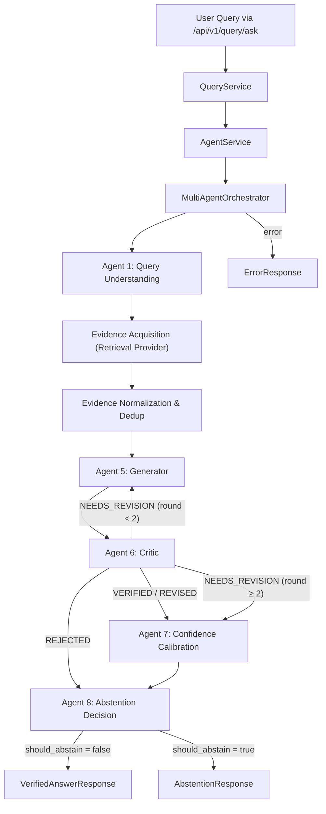

# RAGMedX-MA — Yuvraj AI Pipeline: Final Walkthrough

## Summary

This document summarizes all work completed across Phases 0–7 of the Yuvraj-owned multi-agent AI pipeline for the RAGMedX-MA medical question-answering system. Every phase has been verified with executable tests. The pipeline is fully wired end-to-end through Pranav's mounted FastAPI endpoint `/api/v1/query/ask` and is ready for GPU-backed real inference once CUDA hardware is available and Sana's retrieval engine is connected.

---

## Architecture Overview



---

## Phase-by-Phase Summary

### Phase 0 — Baseline & Test Recovery ✅
- Audited repository, confirmed Python 3.14.3, PyTorch 2.13.0+cpu (no CUDA)
- Configured `pytest.ini` with `asyncio_mode = auto`
- Created synthetic MedQA fixture at [`backend/data/datasets/medqa/sample.jsonl`](file:///d:/Ragmed_2/backend/data/datasets/medqa/sample.jsonl)
- Refactored pre-existing tests into proper pytest format

### Phase 1 — Stabilize Yuvraj-Owned Components ✅
- [`backend/app/llm/parser.py`](file:///d:/Ragmed_2/backend/app/llm/parser.py) — Robust JSON extractor with markdown fence handling and typed exceptions
- [`backend/app/llm/local_llm.py`](file:///d:/Ragmed_2/backend/app/llm/local_llm.py) — `LLMRuntimeMode` enum (MOCK/LOCAL/AUTO), no silent mock fallback
- [`backend/prompts/v1/`](file:///d:/Ragmed_2/backend/prompts/v1/) — 6 canonical Jinja2 prompt templates
- [`backend/app/llm/prompt_templates.py`](file:///d:/Ragmed_2/backend/app/llm/prompt_templates.py) — Versioned prompt loader with fallback dictionary
- All 7 domain agents hardened with `parse_json_from_llm` and trace logging
- Confidence calibration: exact 4-component formula (0.25 retrieval + 0.30 evidence_quality + 0.25 consistency + 0.20 agreement), threshold 0.65
- Abstention decision: safety gates with exact standard copy messages

### Phase 2 — State Contract & Temporary Retrieval Boundary ✅
- [`backend/app/agents/state.py`](file:///d:/Ragmed_2/backend/app/agents/state.py) — Comprehensive `AgentState` with domain enums, deterministic UUID helper, explicit ID policy
- [`backend/app/llm/temporary_retrieval_stub.py`](file:///d:/Ragmed_2/backend/app/llm/temporary_retrieval_stub.py) — Isolated retrieval stub matching Sana's `retrieve_evidence()` signature
- Contract tests for serialization, evidence shape, and retrieval boundary

### Phase 3 — Orchestration State Machine ✅
- [`backend/app/agents/orchestrator.py`](file:///d:/Ragmed_2/backend/app/agents/orchestrator.py) — `MultiAgentOrchestrator` explicit typed async state machine
  - Bounded retrieval loop: `MAX_RETRIEVAL_ITERATIONS = 3`
  - Bounded critic revision loop: `MAX_CRITIC_ROUNDS = 2`
  - Ordered `AgentTraceStep` appended at each node with timestamps and durations
  - Critic routing: VERIFIED/REVISED → confidence, NEEDS_REVISION → re-generate (capped), REJECTED → abstention
- 5 orchestrator tests: verified path, revision loop success, revision cap, empty retrieval abstention, trace ordering

### Phase 4 — Response Builder & Public Interface ✅
- [`backend/app/agents/response_builder.py`](file:///d:/Ragmed_2/backend/app/agents/response_builder.py) — `build_medical_response()` sole boundary function translating `AgentState` → Pranav's master `VerifiedAnswerResponse` / `AbstentionResponse` / `ErrorResponse`
- [`backend/app/agents/__init__.py`](file:///d:/Ragmed_2/backend/app/agents/__init__.py) — Canonical `run_agent_pipeline()` public entry point
- [`backend/app/services/agent_service.py`](file:///d:/Ragmed_2/backend/app/services/agent_service.py) — `AgentService` boundary wrapper
- 6 contract tests covering all three response arms, exact copy messages, trace flag, and service execution

### Phase 5 — Backend Integration Through Existing Boundaries ✅
- [`backend/app/services/query_service.py`](file:///d:/Ragmed_2/backend/app/services/query_service.py) — Minimally connected to `AgentService` (3-line delegation, no schema changes)
- [`backend/tests/test_api_query_integration.py`](file:///d:/Ragmed_2/backend/tests/test_api_query_integration.py) — 4 end-to-end integration tests against the mounted `/api/v1/query/ask` endpoint (401 auth, 200 verified, 422 validation, trace serialization)
- Installed missing runtime dependencies: `sqlalchemy`, `aiosqlite`, `python-jose`, `passlib`, `bcrypt`, `email-validator`, `python-multipart`

### Phase 6 — Prompt Centralization & Evaluation Scaffold ✅
- [`backend/evaluation/metrics.py`](file:///d:/Ragmed_2/backend/evaluation/metrics.py) — 7 evaluation functions: accuracy, precision@k, recall@k, abstention rate, citation support rate, latency metrics, batch evaluator
- [`backend/evaluation/mirage_runner.py`](file:///d:/Ragmed_2/backend/evaluation/mirage_runner.py) — `BenchmarkRunner` scaffold with honest status labeling (`COMPLETED_MOCK_SCAFFOLD` / `BLOCKED_ON_DATASET`)
- [`backend/evaluation/ablation_studies.py`](file:///d:/Ragmed_2/backend/evaluation/ablation_studies.py) — `AblationStudyRunner` with `NOT_RUN` placeholders for deferred configs
- 22 evaluation tests covering all metrics + end-to-end scaffold over synthetic fixture

### Phase 7 — Final Validation & Documentation ✅
- Final test suite: **92 passed, 1 skipped, 0 failed** in 7.78s
- Git working tree reviewed — all changes tracked on `yuvraj/llm` branch
- This walkthrough document produced

---

## Final Test Results

| Metric | Value |
|--------|-------|
| **Total Tests** | 93 |
| **Passed** | 92 |
| **Skipped** | 1 (Sana's `DocumentLoader` — pending) |
| **Failed** | 0 |
| **Errors** | 0 |
| **Duration** | 7.78s |

### Test Coverage by Layer

| Test File | Count | Layer |
|-----------|-------|-------|
| [`test_abstention_decision.py`](file:///d:/Ragmed_2/backend/tests/test_abstention_decision.py) | 9 | Agent: Abstention |
| [`test_confidence_calibration.py`](file:///d:/Ragmed_2/backend/tests/test_confidence_calibration.py) | 5 | Agent: Confidence |
| [`test_critic.py`](file:///d:/Ragmed_2/backend/tests/test_critic.py) | 5 | Agent: Critic |
| [`test_generator.py`](file:///d:/Ragmed_2/backend/tests/test_generator.py) | 4 | Agent: Generator |
| [`test_iterative_retrieval.py`](file:///d:/Ragmed_2/backend/tests/test_iterative_retrieval.py) | 3 | Agent: MGA |
| [`test_query_understanding.py`](file:///d:/Ragmed_2/backend/tests/test_query_understanding.py) | 3 | Agent: Query Understanding |
| [`test_component_stabilization.py`](file:///d:/Ragmed_2/backend/tests/test_component_stabilization.py) | 13 | Cross-cutting stabilization |
| [`test_local_llm.py`](file:///d:/Ragmed_2/backend/tests/test_local_llm.py) | 4 | LLM wrapper |
| [`test_medqa_loader.py`](file:///d:/Ragmed_2/backend/tests/test_medqa_loader.py) | 1 | Dataset |
| [`test_document_loader.py`](file:///d:/Ragmed_2/backend/tests/test_document_loader.py) | 1 (skipped) | Sana boundary |
| [`test_state_and_retrieval_contracts.py`](file:///d:/Ragmed_2/backend/tests/test_state_and_retrieval_contracts.py) | 4 | State & retrieval contract |
| [`test_orchestrator.py`](file:///d:/Ragmed_2/backend/tests/test_orchestrator.py) | 5 | Orchestration state machine |
| [`test_response_builder_and_public_interface.py`](file:///d:/Ragmed_2/backend/tests/test_response_builder_and_public_interface.py) | 6 | Response builder & public API |
| [`test_api_query_integration.py`](file:///d:/Ragmed_2/backend/tests/test_api_query_integration.py) | 4 | End-to-end API integration |
| [`test_evaluation.py`](file:///d:/Ragmed_2/backend/tests/test_evaluation.py) | 22 | Evaluation metrics & runner |

---

## Files Changed (Git Working Tree)

### Modified (Yuvraj-Owned)
| File | Change |
|------|--------|
| [`backend/app/agents/__init__.py`](file:///d:/Ragmed_2/backend/app/agents/__init__.py) | Exported `run_agent_pipeline()` public entry point |
| [`backend/app/agents/abstention_decision.py`](file:///d:/Ragmed_2/backend/app/agents/abstention_decision.py) | Safety gates, exact copy enforcement |
| [`backend/app/agents/confidence_calibration.py`](file:///d:/Ragmed_2/backend/app/agents/confidence_calibration.py) | 4-component weighted formula |
| [`backend/app/agents/critic.py`](file:///d:/Ragmed_2/backend/app/agents/critic.py) | `parse_json_from_llm` hardening |
| [`backend/app/agents/generator.py`](file:///d:/Ragmed_2/backend/app/agents/generator.py) | Citation validation, trace logging |
| [`backend/app/agents/iterative_retrieval.py`](file:///d:/Ragmed_2/backend/app/agents/iterative_retrieval.py) | `parse_json_from_llm`, sub-query checks |
| [`backend/app/agents/orchestrator.py`](file:///d:/Ragmed_2/backend/app/agents/orchestrator.py) | `MultiAgentOrchestrator` state machine |
| [`backend/app/agents/query_understanding.py`](file:///d:/Ragmed_2/backend/app/agents/query_understanding.py) | `parse_json_from_llm` hardening |
| [`backend/app/agents/state.py`](file:///d:/Ragmed_2/backend/app/agents/state.py) | Comprehensive `AgentState`, domain enums |
| [`backend/app/llm/local_llm.py`](file:///d:/Ragmed_2/backend/app/llm/local_llm.py) | `LLMRuntimeMode`, no silent fallback |
| [`backend/app/llm/prompt_templates.py`](file:///d:/Ragmed_2/backend/app/llm/prompt_templates.py) | Versioned Jinja2 loader |
| [`backend/app/services/agent_service.py`](file:///d:/Ragmed_2/backend/app/services/agent_service.py) | `AgentService` boundary |
| [`backend/app/services/query_service.py`](file:///d:/Ragmed_2/backend/app/services/query_service.py) | Connected to `AgentService` |
| [`backend/evaluation/metrics.py`](file:///d:/Ragmed_2/backend/evaluation/metrics.py) | 7 evaluation functions |
| [`backend/evaluation/mirage_runner.py`](file:///d:/Ragmed_2/backend/evaluation/mirage_runner.py) | `BenchmarkRunner` scaffold |
| [`backend/evaluation/ablation_studies.py`](file:///d:/Ragmed_2/backend/evaluation/ablation_studies.py) | `AblationStudyRunner` scaffold |
| [`backend/prompts/v1/*.txt`](file:///d:/Ragmed_2/backend/prompts/v1/) | 6 canonical prompt templates |
| [`backend/requirements.txt`](file:///d:/Ragmed_2/backend/requirements.txt) | Added runtime dependencies |
| [`requirements.txt`](file:///d:/Ragmed_2/requirements.txt) | Synced with backend |

### New Files (Yuvraj-Owned)
| File | Purpose |
|------|---------|
| [`backend/app/agents/response_builder.py`](file:///d:/Ragmed_2/backend/app/agents/response_builder.py) | `build_medical_response()` boundary function |
| [`backend/app/llm/parser.py`](file:///d:/Ragmed_2/backend/app/llm/parser.py) | JSON extraction with typed exceptions |
| [`backend/app/llm/temporary_retrieval_stub.py`](file:///d:/Ragmed_2/backend/app/llm/temporary_retrieval_stub.py) | Isolated retrieval stub (Sana boundary) |
| [`backend/prompts/v1/iterative_retrieval.txt`](file:///d:/Ragmed_2/backend/prompts/v1/iterative_retrieval.txt) | MGA prompt template |
| [`backend/pytest.ini`](file:///d:/Ragmed_2/backend/pytest.ini) | Async test configuration |
| [`backend/tests/test_api_query_integration.py`](file:///d:/Ragmed_2/backend/tests/test_api_query_integration.py) | API integration tests |
| [`backend/tests/test_component_stabilization.py`](file:///d:/Ragmed_2/backend/tests/test_component_stabilization.py) | 13 cross-cutting stabilization tests |
| [`backend/tests/test_evaluation.py`](file:///d:/Ragmed_2/backend/tests/test_evaluation.py) | 22 evaluation metric tests |
| [`backend/tests/test_orchestrator.py`](file:///d:/Ragmed_2/backend/tests/test_orchestrator.py) | 5 orchestration tests |
| [`backend/tests/test_response_builder_and_public_interface.py`](file:///d:/Ragmed_2/backend/tests/test_response_builder_and_public_interface.py) | 6 response/interface tests |
| [`backend/tests/test_state_and_retrieval_contracts.py`](file:///d:/Ragmed_2/backend/tests/test_state_and_retrieval_contracts.py) | 4 state contract tests |
| [`docs/YUVRAJ_ANTIGRAVITY_PROGRESS.md`](file:///d:/Ragmed_2/docs/YUVRAJ_ANTIGRAVITY_PROGRESS.md) | Progress log |

### Preserved / Untouched (Other Owners)
| File | Owner | Status |
|------|-------|--------|
| `backend/app/schemas/document.py` | Pranav | Local changes preserved intact |
| `backend/app/schemas/response.py` | Pranav | Untouched — directly imported |
| `backend/app/schemas/query.py` | Pranav | Untouched |
| `backend/app/api/v1/endpoints/*` | Pranav | Untouched |
| `backend/app/api/deps.py` | Pranav | Untouched |
| `backend/app/retrieval/**` | Sana | Untouched |
| `backend/app/rag/**` | Sana | Untouched |
| `frontend/**` | Shravani | Untouched |

---

## Remaining Work (Environment-Blocked)

| Item | Blocker | Action When Unblocked |
|------|---------|----------------------|
| Real GPU inference | CUDA not available on host | Set `LLMRuntimeMode.LOCAL`, load Qwen3-14B / Llama3.1 |
| Sana retrieval integration | Sana's `retrieve_evidence()` pending | Replace `temporary_retrieval_stub` import in orchestrator constructor |
| Full-scale MedQA benchmark | Requires full dataset + GPU | Run `BenchmarkRunner` with real dataset path |
| MIRAGE benchmark | Requires MIRAGE dataset files | Run `BenchmarkRunner` with MIRAGE JSONL |
| Ablation studies | Requires GPU + full datasets | Implement no-critic and no-MGA baselines in `AblationStudyRunner` |
| Production deployment | Requires Pranav's database + auth stack | Deploy via `uvicorn app.main:app` |

---

## How to Connect Sana's Real Retrieval

When Sana's `retrieve_evidence()` is ready, the only change needed is in the orchestrator constructor:

```diff
# backend/app/agents/orchestrator.py
-from app.llm.temporary_retrieval_stub import retrieve_evidence as default_retrieval_provider
+from app.retrieval.interface import retrieve_evidence as default_retrieval_provider
```

No other files need modification. The orchestrator, response builder, and all downstream components will work unchanged.
